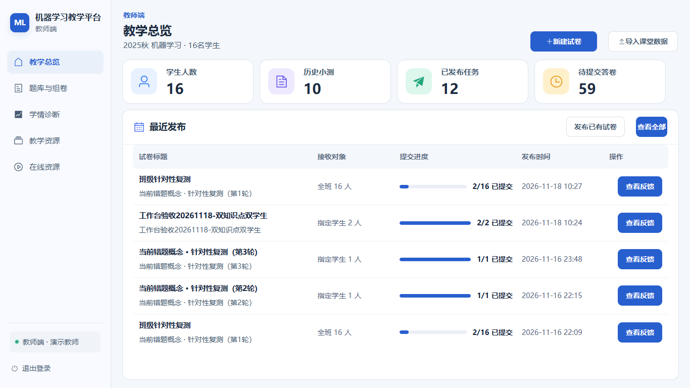
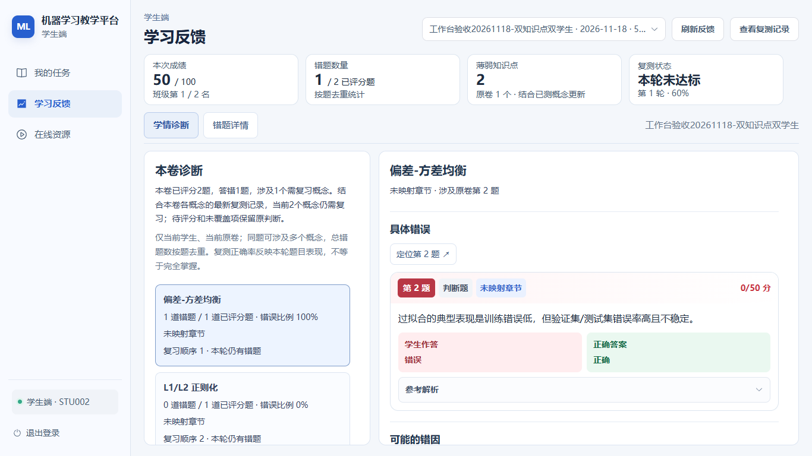
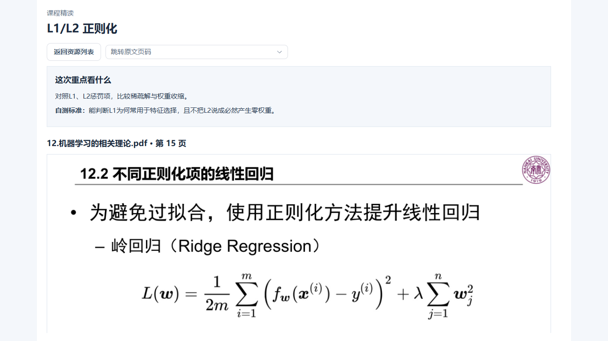
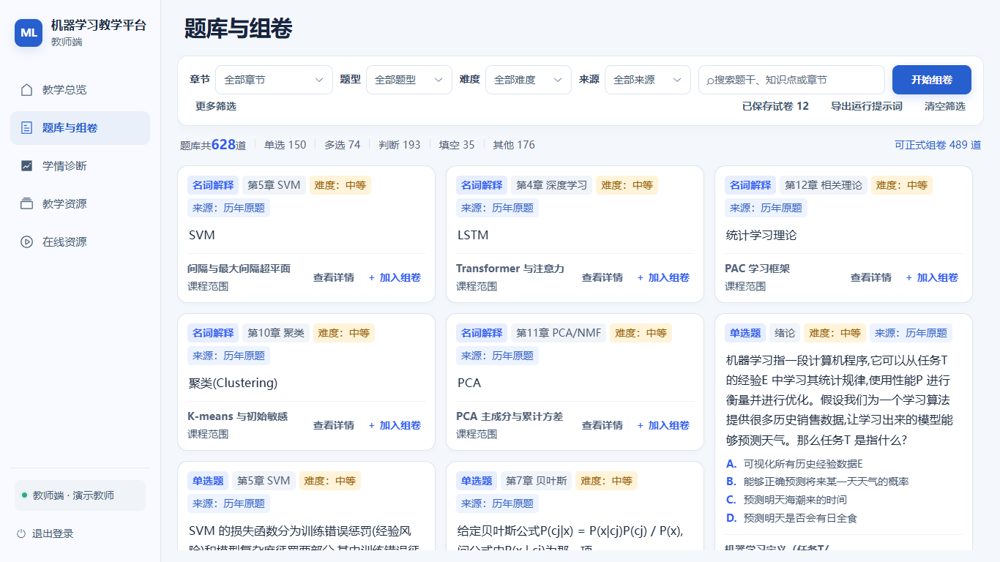

<div align="center">

# 🎓 机器学习学情诊断平台

**从一次小测出发，找到薄弱知识点，用针对性新题检查复习效果。**

教师组卷与发布 · 学生答题与反馈 · AI 诊断 · 课程资源 · 专项复测

`Vue 3` · `TypeScript` · `FastAPI` · `SQLite` · `LangGraph`

[✨ 项目特色](#features) · [🖼️ 界面预览](#screenshots) · [🚀 快速启动](#quick-start) · [🤝 队友接手](#handoff) · [✅ 验证记录](#verification)

</div>

面向机器学习课程的教师—学生双端教学平台，把 **“测验 → 诊断 → 复习 → 复测 → 更新反馈”** 串成可实际操作的学习闭环。仓库附带匿名演示数据与课程素材，启动后即可切换教师、学生身份体验。



<p align="center"><sub>教师工作台 · 课程概况与发布进度一屏查看。截图来自实际运行的匿名验收数据。</sub></p>

<a id="features"></a>

## ✨ 一眼看懂项目特色

| 特色 | 在平台里可以做什么 |
|---|---|
| 👩‍🏫 **教师、学生双端协作** | 教师筛题、组卷、发布与查看提交进度；学生完成考试、查看错题并进入复测。 |
| 🔎 **从一道题到整个班级的诊断** | 查看题目依据、单人单卷、单人多次考试，以及同一次考试中多名学生的共性问题。 |
| 🧠 **有题目依据的 AI 分析** | 分数与错误分布由程序计算；AI 结合真实作答解释可能的错因，区分客观事实与推断。 |
| 🎯 **针对薄弱点的专项复测** | AI 生成候选新题，经过范围检查和独立验答后发布；交卷后保存前后对比、更新诊断。 |
| 📚 **学完就能继续练** | 按知识点推荐课程原页与外部资源，提供阅读重点、自测标准和真实页码入口。 |
| 🖥️ **固定工作台布局** | 导航、标题与核心操作保持固定，长题目、表格和报告在各自区域滚动；支持小窗口与浏览器缩放。 |

### 🔄 一个完整的使用流程

**教师选题/生成题目 → 组卷发布 → 学生作答 → 评分保存 → 查看诊断 → 阅读推荐资料 → 发布专项复测 → 再次作答 → 对比并更新反馈**

两条出题入口保持各自的策略：

- **普通组卷：题库优先，缺题才由 AI 补充。**
- **诊断页专项复测：依据薄弱知识点生成 AI 新题，独立验答通过后发布。**

复测记录关联到具体学生、原卷、知识点和轮次。未覆盖的知识点继续保留，待评分不能算通过；一次复测达标也不等于长期掌握。

<a id="screenshots"></a>

## 🖼️ 看看实际界面

### 学习反馈：先看诊断，再追到具体错题

“学情诊断 / 错题详情”双视图，让学生沿着知识点查看题目依据、可能错因、概念纠正、推荐资料和复测结果。



<p align="center"><sub>保留原卷成绩，同时根据有效复测更新当前薄弱点；图中结果是实际验收记录。</sub></p>

<details>
<summary><strong>📚 展开查看：课程精读与题库组卷</strong></summary>

### 课程精读：直接定位到真实课件页

**35 个课程知识点、80 张唯一原课件页**随项目提供，支持离线阅读。每个知识点包含复习重点与自测标准；B站、帖子、抖音等相关外链作为补充。



### 题库与组卷：筛选、查看、加入试卷

按章节、题型、难度和来源筛选题目，查看详情后加入组卷；教师也可以导出实际模型运行提示词。



</details>

截图为 **1366 × 768 的真实页面**，使用匿名演示身份；不同快照的题目和任务数量可能不同。更多页面和原始验证记录见 [验收说明与截图索引](docs/WORKBENCH_ACCEPTANCE.md)。

<a id="quick-start"></a>

## 🚀 本地快速启动

### 1. 准备环境

| 环境 | 要求 |
|---|---|
| 系统 | Windows 10/11 + PowerShell |
| Python | **3.13**，已按依赖锁文件验证 |
| Node.js | **20+**，附带 npm；运行前端单元测试建议使用 **Node 24** |
| 网络 | 首次安装依赖和真实 AI 调用需要网络；随包课件可离线阅读 |

### 2. 获取代码并启动

```powershell
git clone https://github.com/ZhuoranLi2007/mlquiz-platform.git
cd mlquiz-platform
.\start.ps1
```

脚本会创建 Python 虚拟环境、安装依赖、恢复匿名演示数据和课程素材、准备本机演示凭据，再构建前端并启动 **后端 + worker**。ZIP 交付版可以使用随包的生产构建。已有数据库不会被默认快照覆盖。

### 3. 选择身份，体验流程

打开 **[http://127.0.0.1:8000/](http://127.0.0.1:8000/)**，在登录页选择：

- 👩‍🏫 **演示教师**：进入题库组卷、发布任务、查看学情诊断。
- 👨‍🎓 **STU001—STU016**：查看待完成任务、答题和学习反馈。

教师和学生可以分别在两个浏览器标签页登录，身份互不覆盖。教师发布后，学生刷新“我的任务”即可查看。**组卷和 AI 干预依赖后台 worker，请保持它运行。**

<details>
<summary><strong>🔧 常用启动命令</strong></summary>

```powershell
.\start.ps1 -Port 8001        # 默认端口被占用时，换一个端口
.\start.ps1 -NoBrowser        # 启动但不自动打开浏览器
.\start.ps1 -RebuildFrontend  # 修改前端后重新构建
.\start.ps1 -Check            # 检查服务状态
.\start.ps1 -Stop             # 停止本目录服务，保留数据
```

Python 不在 PATH 时，可传入 `-PythonExe 'Python3.13解释器的绝对路径'`。完整启动和独立快照恢复步骤见 [交付说明](docs/FINAL_DELIVERY.md)。

</details>

### 🤖 可选：接入真实 AI

没有模型配置时，可以使用已有题库、考试、评分和已有诊断。刷新 AI 分析或生成新复测题，需要配置有效模型。

首次配置时，将 `.env.example` 复制为 `.env`；**如果已有 `.env`，直接编辑，保留原配置**。填写：

```dotenv
MLQ_MODEL_PROVIDER=deepseek
MLQ_MODEL_BASE_URL=https://api.deepseek.com
MLQ_MODEL_CHAT_MODEL=deepseek-chat
MLQ_MODEL_API_KEY=你的密钥
```

`.env` 已被 Git 忽略，密钥不随仓库分发。实际模型请求和响应会记录并脱敏，教师可通过“题库与组卷 → 导出运行提示词”下载。

<a id="handoff"></a>

## 🤝 队友从这里接手

建议先跑通演示，再按自己负责的模块阅读源码。**默认启动使用原始匿名快照**；要复查截图中的双学生闭环，请按 [工作台验收说明](docs/WORKBENCH_ACCEPTANCE.md#本地启动与恢复本轮结果) 恢复 `workbench-review` 快照到新目录。

| 想优化的部分 | 优先看这里 |
|---|---|
| 页面布局与公共样式 | [`WorkbenchPage.vue`](frontend/src/components/WorkbenchPage.vue)、[`workbench.css`](frontend/src/styles/workbench.css) |
| 学生反馈与诊断展示 | [`StudentFeedbackView.vue`](frontend/src/views/StudentFeedbackView.vue)、[`feedback_workbench.py`](backend/app/services/feedback_workbench.py) |
| 教师诊断与多个范围 | [`TeacherAnalysisView.vue`](frontend/src/views/TeacherAnalysisView.vue)、[`classroom_diagnosis.py`](backend/app/services/classroom_diagnosis.py) |
| 组卷、AI 出题与复测 | [`bank_service.py`](backend/app/services/bank_service.py)、[`automatic_retest.py`](backend/app/services/automatic_retest.py)、[`targeted_retest.py`](backend/app/services/targeted_retest.py) |
| LangGraph 与可执行 skill | [`graphs/`](backend/app/graphs/)、[`skills/`](backend/app/skills/)、[`worker.py`](backend/app/workers/worker.py) |
| 课程资料与资源推荐 | [`learning_resources.py`](backend/app/services/learning_resources.py)、[`LearningMaterialView.vue`](frontend/src/views/LearningMaterialView.vue) |

```text
backend/app/          API、业务服务、数据模型、LangGraph 与 skill
backend/tests/        后端回归测试
backend/scripts/      数据恢复、验证与打包工具
frontend/src/         Vue 页面、组件与样式
frontend/tests/       前端测试
data/demo/            原始匿名快照与实际课程素材
data/acceptance/      各阶段脱敏验收快照
docs/submission/     报告、PDF 与可编辑 PPT
docs/verification/   截图、真实调用与验证证据
start.ps1            Windows 一键启动脚本
```

### 开发与检查

后端与 worker 用 `start.ps1` 启动后，可以另开终端运行前端开发服务：

```powershell
cd frontend
npm ci
npm run dev
```

开发页面为 [http://127.0.0.1:5173/](http://127.0.0.1:5173/)，默认代理到后端 `8000` 端口。如果后端使用 `8001`，在运行 `npm run dev` 的终端先设置 `$env:MLQ_DEV_API_URL='http://127.0.0.1:8001'`。

```powershell
# 在项目根目录执行后端测试
.venv\Scripts\python.exe -X utf8 -m pytest -q

# 在 frontend 目录执行前端检查
npm run test:unit
npm run typecheck
npm run build
```

继续优化时，请在独立分支开发，使用隔离测试数据；修改旧库前先备份。尤其保留 **普通组卷的来源策略、多人复测独立关联、待评分与未覆盖知识点的判断规则**。改动相关流程后，再核对页面、接口和数据库是否一致。

<a id="verification"></a>

## ✅ 做到了什么，如何核验

以下是 **2026-11-18 验收记录**，具体范围与边界见 [完整对照表](docs/WORKBENCH_ACCEPTANCE.md)。

| 验证层次 | 已记录的结果 |
|---|---|
| 自动化回归 | 后端 **189 项**、前端 **33 项**通过；类型检查与生产构建通过 |
| 真实浏览器 | **102 组尺寸检查**、**33 组真实缩放检查**，另有文本预览 6 个尺寸检查 |
| 双学生复测 | 同一班级复测试卷，两人分别 **10/10、6/10**；原卷、轮次、评分与诊断独立保存 |
| 真实模型记录 | 累计 **116 条**请求与响应，保留失败及未通过内容校验的记录，不能全部视为成功调用 |
| 独立解压启动 | 默认数据与验收快照均完成启动复查，前端、后端、worker、资源与浏览器检查通过 |

**自动化通过、真实模型执行和真实浏览器操作分别留证。** 不用接口成功或测试数量替代完整流程验收。

### 📖 文档与答辩材料

| 资料 | 内容 |
|---|---|
| [工作台与学习反馈验收](docs/WORKBENCH_ACCEPTANCE.md) | 最新功能对照、修改清单、截图索引、复查方法和已知边界 |
| [老师要求逐项核查](docs/REQUIREMENTS_AUDIT.md) | 题库、诊断、推荐、复测、LangGraph 与 skill 的实现和证据 |
| [AI 出题复测专项](docs/AI_RETEST_REVIEW.md) | 出题来源、独立验答、评分与多人复测规则 |
| [诊断与资源专项](docs/DIAGNOSIS_RESOURCE_REVIEW.md) | 知识点诊断、真实课程原页和资源入口 |
| [课程报告 · Word](docs/submission/course_report.docx) / [PDF](docs/submission/course_report.pdf) | 8 页技术报告与实际验证说明 |
| [展示 PPT](docs/submission/course_demo.pptx) | 8 页可编辑幻灯片，含讲解备注 |
| [提示词与历史边界](docs/PROMPT_HISTORY.md) | 实际模型运行记录与不可补造的历史材料 |

### 🔐 数据与使用边界

仓库包含 16 名匿名学生的演示数据，验收快照已清除密码哈希和登录会话；不包含本机密钥、私人原始数据库或真实学生姓名。课程素材用于本地教学演示，外部资源可能随站点变化，随包原课件页可离线使用。

快速登录面向本地课程演示。部署到共享网络前，需要关闭 `MLQ_QUICK_LOGIN_ENABLED`、设置 HTTPS，并完善账户初始化与访问控制。

指定开发平台的历史记录、早期开发提示词原件和真实成员信息尚缺可靠材料，未补造。已验证的软件范围内未留已知阻断问题；具体限制和历史失败均保存在验收文档中。
