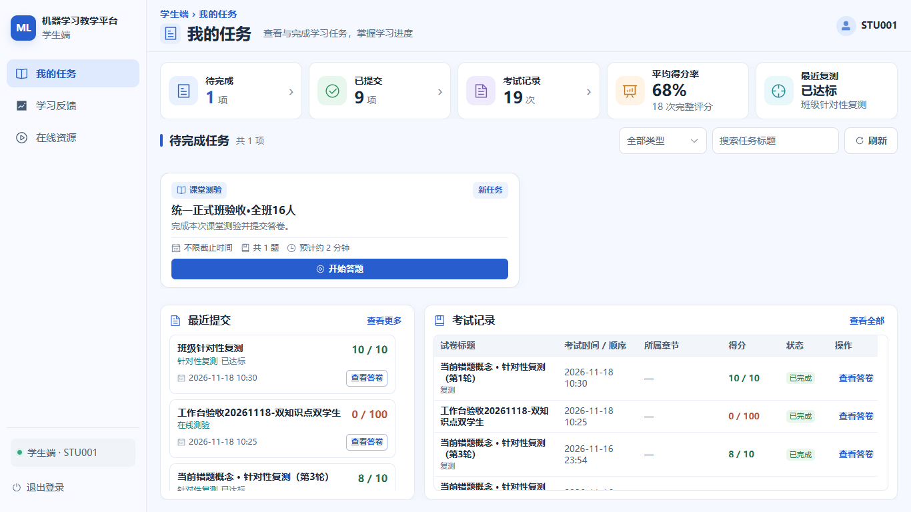
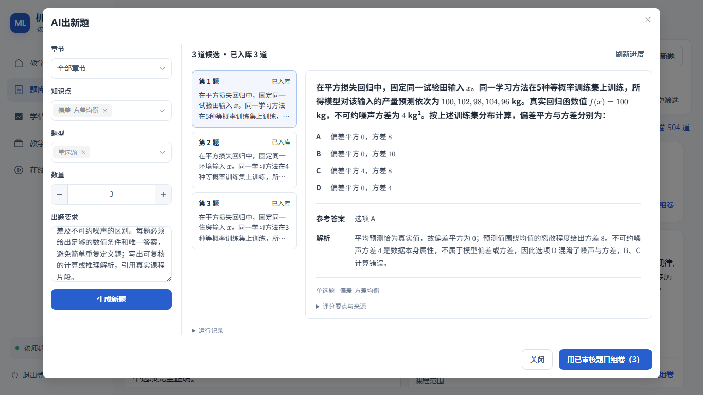
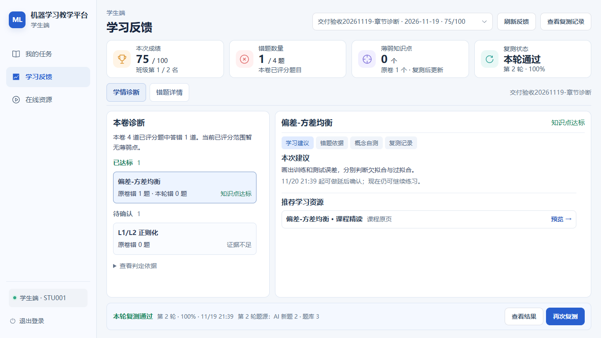
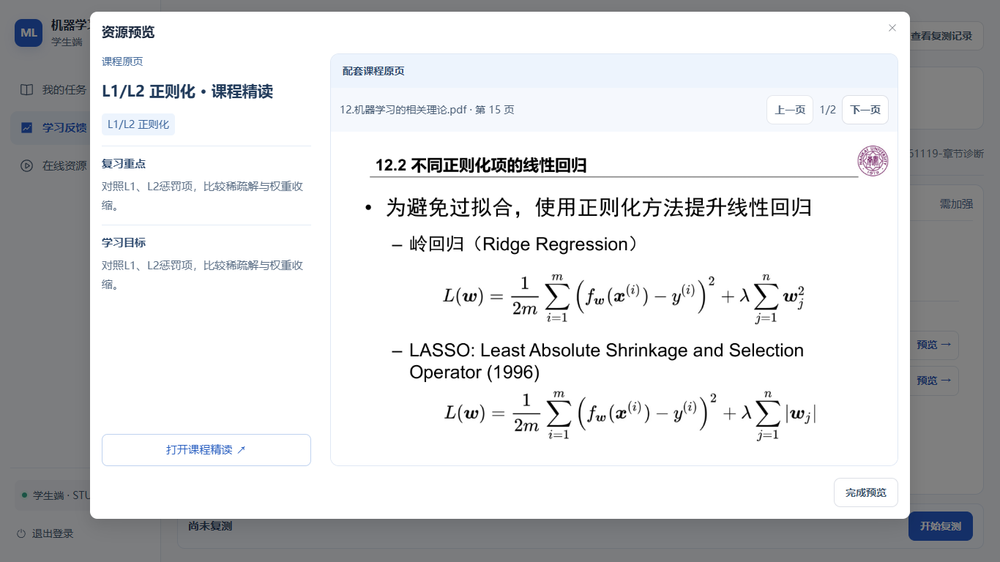
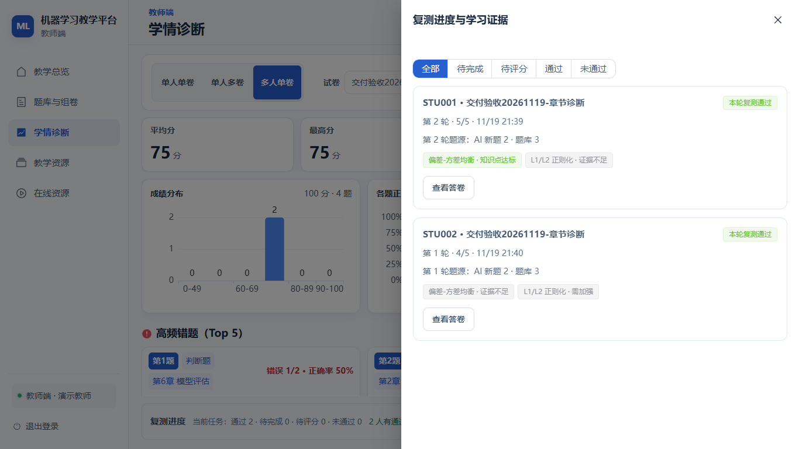

<div align="center">

# 🎓 机器学习学情诊断平台

**把小测、错题、学习资源和针对性复测连成一条看得见的学习路径。**

👩‍🏫 教师组卷与诊断　·　👨‍🎓 学生作答与反馈　·　🤖 AI 出题　·　📚 课程原页　·　🎯 专项复测

`Vue 3` · `TypeScript` · `FastAPI` · `SQLite` · `LangGraph`

[✨ 项目亮点](#highlights) · [🖼️ 界面实拍](#screenshots) · [🚀 快速体验](#quick-start) · [🧱 技术实现](#tech) · [✅ 验证与报告](#verification)

</div>

这是一个面向机器学习课程的教师、学生双端小测平台。教师可以从题库或 AI 候选题组卷、发布考试并查看学情；学生完成任务后，可以沿着 **答题 → 错题反馈 → 学习资源 → 新题复测 → 反馈更新** 继续学习。仓库提供匿名演示数据，方便在本机体验完整流程。

<a id="highlights"></a>

## ✨ 项目亮点

| | 已实现的体验 |
|---|---|
| 🧩 **从题目看到班级** | 教师可查看单人单卷、单人多卷和多人单卷诊断；成绩分布、题目正确率、错误依据与学生差异都有对应页面。 |
| 🧠 **AI 与规则各做擅长的事** | 程序负责评分、统计与复测证据判定；配置模型后，AI 可解释错因、生成候选题。候选题经过检查，教师能修订并审核入库。 |
| 🎯 **复测结果不只看总分** | 平台分别记录“本轮通过”“知识点达标”和“练习完成”。重复题全对不会直接变成新题达标证据，历史成绩和轮次仍可查看。 |
| 📖 **建议能打开原资料** | 反馈按知识点推荐复习内容，站内可预览配套课程原页、查看页码与学习重点；在线资源保留真实封面和原站入口。 |
| 🔄 **教师、学生读同一份证据** | 学生看到待办、答卷、错题和复测记录；教师可以在个人与班级诊断中读回对应的进度和结果。 |

新增[班级知识点矩阵与自适应学习路径](docs/MATRIX_ADAPTIVE.md)：教师按固定试卷版本查看学生差异并发布分组训练；学生根据实际证据进入基础巩固、应用验证、迁移巩固或延后确认。资料、训练与证据入口相互连通，题库不足时明确标为巩固练习。

### 🧭 一条真实运行的学习路径

**👩‍🏫 选题与发布 → 👨‍🎓 完成小测 → 📊 查看错题和学情 → 📚 阅读课程原页 → 🎯 发起专项复测 → ✍️ 再次作答 → 🔄 更新反馈**

隔离演示中，教师真实生成并审核了 **3 道 AI 候选题**。随后两名匿名学生分别完成含新题的正式复测：STU001 得 **10/10**，目标知识点达标；STU002 得 **8/10**，本轮通过，但 L1/L2 正则化仍显示“需加强”。这也说明整轮通过与知识点达标是两种不同结论。[查看任务、答卷与截图记录](docs/acceptance/demo-polish-20261119/ACCEPTANCE_AND_SCREENSHOTS.md)

<a id="screenshots"></a>

## 🖼️ 界面实拍

以下均为真实浏览器中的匿名演示页面。不同截图来自不同验收时点，任务数量可能不同；重点界面按 **1366 × 768** 检查。

| 👩‍🏫 教学总览 | 👨‍🎓 我的任务 |
|---|---|
|  |  |

### 🤖 AI 出新题：配置、候选审核与入库

教师选择知识点、题型和题量后，可以逐题核对题干、选项、参考答案、解析与来源，必要时保存修订版本，再将审核通过的题目加入题库和组卷草稿。模型调用需要本机配置有效密钥；下图使用此前真实生成并审核的题目，没有伪造模型输出。



| 🔎 学习反馈与复测 | 📚 推荐资料的课程原页预览 |
|---|---|
|  |  |

### 📊 班级诊断：同卷学生可以有不同结论

教师能查看同一次考试中不同学生的复测进度。下图中，STU001 的偏差—方差知识点达标；STU002 虽然本轮通过，L1/L2 正则化仍需加强。



更多实拍页面见 [📸 最终截图清单](docs/acceptance/FINAL_SCREENSHOT_CATALOG.md)，AI 出题的字体与阅读布局前后对比见 [优化对照图](docs/acceptance/ai-visual-20261119/screenshots/comparison_approved_detail.png)。

## 🧰 平台实现了什么

| 入口 | 可以完成的操作 |
|---|---|
| 👩‍🏫 **教师端** | 查看教学总览；按章节、知识点、题型、难度和来源筛选题库；查看题目、答案、解析与来源；手动、AI 或混合组卷；发布试卷、查看提交与学情诊断。 |
| 🤖 **出题与审核** | 独立配置 AI 出新题任务，查看候选与运行进度，修订内容、审核入库，并用已审核题目组卷。普通组卷优先使用题库，缺题时才尝试 AI 补题。 |
| 👨‍🎓 **学生端** | 在“我的任务”查看待办与历史记录，完成考试、查看成绩与错题依据；从学习反馈进入资源预览、发起或继续专项复测，查看各轮结果。 |
| 📚 **课程资源** | 随匿名演示数据提供 **35 个知识点、82 处课程原页引用**；站内预览原页并保留相关外部资源入口。外部站点的实际可访问性由站点决定。 |
| 🔐 **数据与身份** | SQLite 保存试卷版本、答卷、评分、诊断与复测记录；本地演示提供教师及 STU001—STU016 匿名身份，教师、学生可在不同标签页分别登录。 |

<a id="quick-start"></a>

## 🚀 本地快速体验

**环境：** Windows 10/11、PowerShell、Python **3.13**、Node.js **20+**。首次安装依赖需要网络；随项目提供的课程原页可以在本机阅读。

```powershell
git clone https://github.com/ZhuoranLi2007/mlquiz-platform.git
cd mlquiz-platform
.\start.ps1
```

启动脚本会准备虚拟环境和依赖、恢复匿名演示数据、生成本机演示凭据，并启动前端、FastAPI 与后台 worker。浏览器打开 **http://127.0.0.1:8000/** 后，选择“演示教师”或 STU001—STU016 即可体验。组卷和 AI 后台任务需要 worker 保持运行。

<details>
<summary><strong>🛠️ 常用启动命令</strong></summary>

```powershell
.\start.ps1 -NoBrowser        # 启动但不自动打开浏览器
.\start.ps1 -Port 8001        # 默认端口被占用时换端口
.\start.ps1 -RebuildFrontend  # 修改前端后重新构建
.\start.ps1 -Check            # 查看服务状态
.\start.ps1 -Stop             # 停止本目录服务，保留数据
```

</details>

### 🤖 需要真实 AI 时

题库、考试、评分和已有诊断无需模型密钥。要运行新的 AI 分析或出题任务，请在项目根目录的 `.env` 中填写以下配置；已有文件时编辑相应字段。

```dotenv
MLQ_MODEL_PROVIDER=deepseek
MLQ_MODEL_BASE_URL=https://api.deepseek.com
MLQ_MODEL_CHAT_MODEL=deepseek-chat
MLQ_MODEL_API_KEY=你的密钥
```

2026年11月22日的增量验收、最终交付文件和课堂演示路径见 [本轮验收索引](docs/ACCEPTANCE_20261122.md)。教师题库支持新增、版本化编辑和停用，学生可在资源预览中保存收藏。

学生学习反馈新增[知识点地图与证据时间线](docs/KNOWLEDGE_JOURNEY.md)。按章节和掌握状态定位知识点后，可以查看原卷与复测依据、阅读对应资料并保存阅读记录。

`.env` 已被 Git 忽略。平台会明确区分模型配置、任务运行和生成结果，不把未配置的模型当作成功生成。

<a id="tech"></a>

## 🧱 技术实现

| 层次 | 实际使用 |
|---|---|
| 🎨 前端 | Vue 3、TypeScript、Element Plus；ECharts 展示诊断图表，KaTeX 排版数学公式。 |
| ⚙️ 后端 | FastAPI 提供教师、学生和资源接口；SQLite 保存业务记录及版本；后台 worker 处理异步任务。 |
| 🧠 AI 工作流 | LangGraph 编排诊断、推荐、出题与复测流程；程序检查题目、答案和学习证据，教师审核候选题。 |
| 🧪 验证 | 前端单元测试、TypeScript 类型检查、生产构建，后端测试和真实浏览器操作均有留档。 |

<a id="verification"></a>

## ✅ 验证与报告

最近一次完整交付记录为 **后端 219 项、前端 45 项测试通过**，并完成类型检查、生产构建与真实浏览器验收。AI 出题界面还单独检查了 1366 × 768 下的三栏宽度、局部滚动、中文与公式显示；原始成绩和题目历史没有因视觉调整被改写。[查看最终验收说明](docs/acceptance/FINAL_DELIVERY_NOTE.md)

- 📄 [课程实验报告 Word](docs/submission/course_report_detailed_final.docx) · [PDF](docs/submission/course_report_detailed_final.pdf)
- 🖼️ [完整截图清单](docs/acceptance/FINAL_SCREENSHOT_CATALOG.md) · [AI 界面优化前后对比](docs/acceptance/ai-visual-20261119/screenshots/comparison_approved_detail.png)
- 🔍 [学习闭环验收](docs/LEARNING_LOOP_V3_ACCEPTANCE.md) · [AI 出题与复测专项核查](docs/AI_RETEST_REVIEW.md)

🔐 演示账号和数据为匿名课程样例。快速登录用于本机演示，模型密钥不会随仓库分发。
