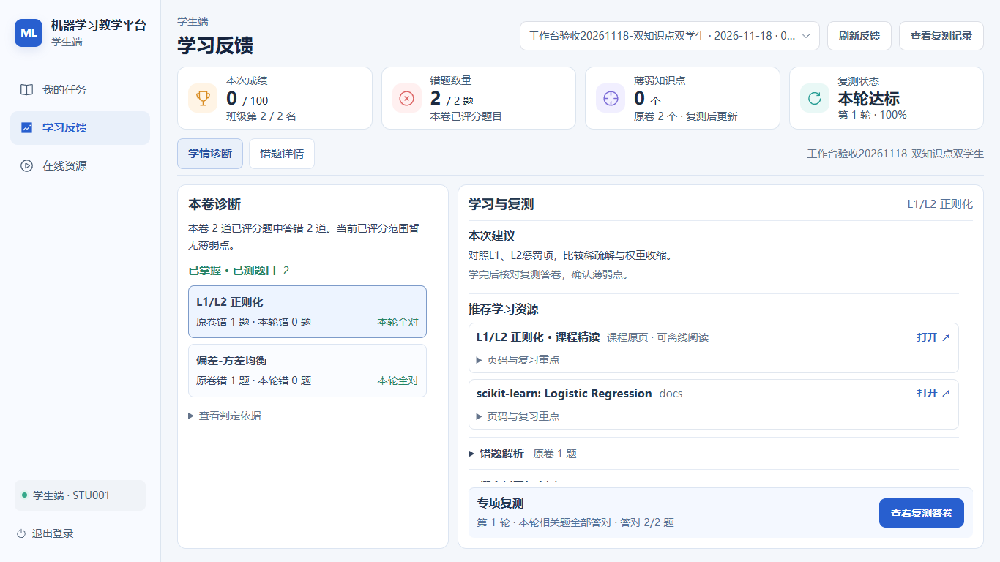

# 学生学习反馈页界面验收

日期：2026-11-18。范围：学生端学习反馈的展示与布局；沿用现有后端、数据接口、推荐内容和复测流程。

## 修改内容与实现方式

- `frontend/src/views/StudentFeedbackView.vue`：四张 86px 数据卡增加小图标；左侧显示简短诊断和知识点分组，右侧按建议、资源、详细解析排列。
- 采用 CSS Grid 双栏，右栏内部采用 Flex。可滚动内容设置 `min-height: 0; overflow: auto`，底部复测操作位于滚动区之外，因此长解析不会把按钮推到屏幕下面。正文保持 14px，资源与知识点名称为 15–16px。
- 长错因、概念纠正、自测标准、原卷及复测错题、历次复测记录通过原生 `details/summary` 折叠保留。知识点切换后折叠状态重置，阅读区回到顶部。
- `LearningResourceList.vue` 增加可选 `compact` 展示模式；学生反馈默认展示前两项，其余可展开。链接地址、顺序、去重与安全过滤沿用原实现；其他页面仍使用原来的默认模式。
- `feedbackDisplay.ts` 只负责分组和中文标签：已掌握限定于已测题目；待评分、未覆盖、待作答不会进入该组。诊断和评分仍以接口结果为准。
- 对照修改前源码确认：加载反馈、切换试卷、记忆知识点、定位题目、打开复测的原有函数保持一致。没有修改后端业务代码或数据库结构。
- README 已替换为本次实际页面截图，旧验收截图保留。

## 实际浏览器结果

使用本机 `http://127.0.0.1:8004` 正在运行的服务，重新构建前端后，通过真实 Chromium 登录匿名演示账号 STU001、STU002；未拦截或模拟接口。

| 检查项 | 实际结果 |
| --- | --- |
| 1366×768 首屏 | 四张指标卡、学习建议、资源入口、底部复测按钮完整可见；页面本身无横向、纵向滚动 |
| 内部长内容 | 展开解析、复测历史后仅内部区域滚动，可到达底部，顶部导航不移动 |
| 不同尺寸 | 两账号分别检查 1366×768、1280×720、1440×900、1920×1080、640×720、910×512，共 12 组通过；窄屏采用内部纵向布局 |
| 分数与原卷关联 | 页面、接口、SQLite 记录一致；两学生原卷分别为 0/100、50/100，复测分别为 10/10、6/10 |
| 知识点状态 | 复测全对的学生显示已测题目已掌握；原卷答对但复测答错的知识点仍显示需加强 |
| 多轮复测 | 真实旧原卷分别有 3 轮、2 轮记录；整轮达到达标线仍可存在需加强知识点，两种状态分别显示 |
| 学习资源 | 与接口推荐地址逐一对应；外链保留新窗口属性；点击本地课程链接并确认原课件图片实际加载成功 |
| 解析与自测 | 可展开原卷/最新复测错题、概念纠正、自测标准、历次复测；题目内容和题数与接口一致 |
| 导航交互 | 点击错题定位、切换双视图、切换试卷并恢复所选知识点、复测记录抽屉 Tab/Escape 均通过 |
| 复测入口 | 两个账号分别进入自己的已提交复测答卷，原卷关联不串用 |
| 尚未安排复测 | 两个账号各检查一份真实历史原卷，显示等待教师发布，不出现虚构复测按钮 |
| 数据保护 | 本轮验证前后所有历史答卷的学生、分数、状态、评分状态和原卷关联字段一致 |

原始记录：[browser-results.json](verification/feedback-ui/browser-results.json)。没有安排复测的实际样本记录在各账号的 `no_retest` 字段；不会为演示按钮而伪造任务。

## 自动化验证与边界

- 前端单元测试 **36/36 通过**，包括新增的 3 项掌握状态边界测试；`vue-tsc --noEmit` 和 Vite 生产构建通过。
- 实际浏览器检查无页面异常，记录中的 `failures`、`errors` 均为空。界面已人工查看截图，未发现文字溢出、卡片拥挤或主要按钮遮挡。
- 本次没有调用模型或新建复测，没有重新验收 AI 出题质量。现有隔离闭环样本的复测均已完成，“开始复测”的新作答流程不作为本次实测完成项；其原有函数未改动。待评分、未覆盖等边界由自动化测试验证，不冒充真实新答卷验收。
- 本次界面优化没有遗留阻塞；原有项目验收边界仍以原记录为准。

## 复查方式

按主 README 启动服务并使用 `workbench-review` 隔离数据，选择 STU002 登录，进入「学习反馈」，选择“工作台验收20261118-双知识点双学生”。STU001 可查看全部答对后的另一种状态。

```powershell
# 在仓库根目录执行；Python 环境需有 Playwright，且已安装 Chromium。
python backend/scripts/verify_feedback_ui.py `
  --base-url http://127.0.0.1:8004 `
  --database data/workbench-review/db/mlquiz.sqlite3 `
  --cycle-record docs/verification/workbench/cycle-record.json `
  --output docs/verification/feedback-ui `
  --chromium "你的 Chromium 可执行文件路径"

cd frontend
npm run test:unit
npm run typecheck
npm run build
```



